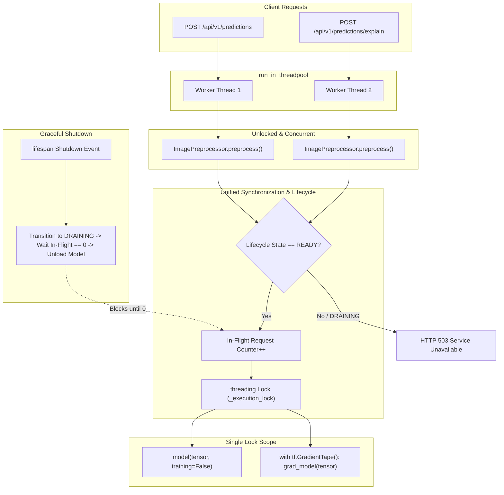

# LungCare AI — System Architecture & Platform Design

## 1. Executive Summary

LungCare AI is a modern, extensible AI-assisted chest X-ray research and medical information assistance platform designed to support clinicians and medical researchers. The platform combines deep learning computer vision (DenseNet121) with explainable AI (Grad-CAM), retrieval-augmented generation (RAG), and agentic workflows (LangGraph).

> **Disclaimer:** LungCare AI is a research prototype intended for clinical research and academic evaluation. It is not FDA-approved or certified for primary diagnostic decision-making.

---

## 2. Architectural Blueprint

```mermaid
flowchart TD
    Client["Frontend Client (Next.js / Tailwind)"] -->|HTTPS / REST| Gateway["FastAPI API Gateway (/api/v1)"]

    subgraph Backend ["LungCare AI Backend Core"]
        Gateway --> Auth["Security & Middleware (CORS, Rate Limit)"]
        Gateway --> Health["Health & Readiness Probes"]
        Gateway --> Discovery["Discovery & OpenAPI Metadata\n- /openapi.json & /api/v1/openapi.json\n- / & /api/v1/"]

        Auth --> ServiceLayer["Service Orchestration Layer (app/api/deps.py)"]

        subgraph Services ["Domain Services"]
            InferenceService["Inference Service (DenseNet121)"]
            GradCAMService["Explainability Service (Grad-CAM)"]
            ImagePreprocessor["Image Preprocessing Service"]
            GradCAMVisualizer["Grad-CAM Visualizer Service"]
            RAGService["Medical Info Assistance (RAG - Future)"]
            AgentWorkflow["Multi-Agent Orchestrator (LangGraph - Future)"]
        end

        ServiceLayer --> Services
    end

    subgraph Storage ["Artifacts & Models"]
        ModelDir["models/LungCare_AI_Model/\n- lungcare_densenet121.h5\n- lungcare_config.json\n- lungcare_evaluation.json"]
        InferenceService -.->|Loads Weights (Phase 2.2)| ModelDir
        ChromaDB[("ChromaDB Vector Store\n(Phase 2.3)")]
        RAGService -.-> ChromaDB
    end

    subgraph External ["External AI Services"]
        GeminiAPI["Google Gemini LLM"]
        AgentWorkflow -.-> GeminiAPI
        RAGService -.-> GeminiAPI
    end
```

---

## 3. Classification Taxonomy & Specifications

The pre-trained DenseNet121 model identifies four distinct radiological classes:

| Class Index | Internal Key    | Display Name | Clinical Description                                                                    |
| :---------: | :-------------- | :----------- | :-------------------------------------------------------------------------------------- |
|      0      | `COVID19`       | COVID-19     | Viral respiratory illness caused by SARS-CoV-2 showing bilateral ground-glass opacities |
|      1      | `NORMAL`        | Normal       | Clear lung fields with no acute focal consolidation or pleural effusion                 |
|      2      | `PNEUMONIA`     | Pneumonia    | Infectious inflammation causing pulmonary infiltrates or consolidation                  |
|      3      | `TURBERCULOSIS` | Tuberculosis | Mycobacterial infection manifesting apical infiltrates, cavitation, or lymphadenopathy  |

- **Input Dimensions:** 224 × 224 × 3 (RGB)
- **Input Preprocessing:** `tf.keras.applications.densenet.preprocess_input`
- **Validation Accuracy:** 97.68% (Weighted Macro F1: 0.9769)

---

## 4. Multi-Phase Roadmap

- **Phase 2.1 (Current):** Backend Foundation, configuration management, health/readiness probes, centralized logging with millisecond precision, dual OpenAPI endpoints, and async testing harness.
- **Phase 2.2:** DenseNet121 model loading lifecycle, image validation pipeline, multi-class inference, and Grad-CAM visual heatmap generation.
- **Phase 2.3:** RAG pipeline integration with LangChain, ChromaDB, and medical literature vector indexing.
- **Phase 2.4:** LangGraph multi-agent diagnostic consultation and explanation workflow.
- **Phase 2.5:** Patient report synthesis and exportable clinical summaries.
- **Phase 3.0:** Frontend web interface.

---

## 5. Runtime Architecture & Compatibility Strategy

To ensure zero instability when transitioning from the backend foundation into deep learning model inference (Phase 2.2), the runtime architecture defines the following environment tiers:

1. **Host Python 3.11 Environment (Recommended Primary):**
   - TensorFlow (2.15–2.18) and Keras 3 provide official, pre-compiled binary distributions for Python 3.11 on Windows, Linux, and macOS.
   - Python 3.13 is supported for the API foundation layer, but dedicated Python 3.11 virtual environments are designated for deep learning runtime stability.

2. **Windows vs. Linux Acceleration Strategy:**
   - **Local Windows Dev (CPU):** Direct execution using Uvicorn on Windows host for rapid iteration.
   - **Local Windows Dev (GPU):** WSL2 (Ubuntu 22.04 / 24.04 LTS) with NVIDIA Container Toolkit for direct CUDA hardware acceleration.
   - **Production (Container):** OCI-compliant container using `python:3.11-slim` or NVIDIA CUDA base images deployed on managed orchestrators (GKE, Cloud Run, AWS ECS).

---

## 6. Phase 2.2 Deep Learning Prediction & Grad-CAM Explainability Subsystem

### 6.1 Architectural Workflow

The complete prediction and explainability request lifecycle operates as an in-memory pipeline:

```
[Client Multipart Upload]
         │
         ▼
[FastAPI /api/v1/predictions/explain]
         │ (run_in_threadpool offload)
         ▼
[ImagePreprocessor] ── Validate MIME/magic bytes ── Check pixel limits (25 MP) ── EXIF transposition
         │ ── Deterministic white alpha composite ── Lanczos 224x224 ── TensorFlow preprocess_input
         ▼
[InferenceService] ── DenseNet121 forward pass (thread-synchronized) ── Softmax probabilities
         │
         ▼
[GradCAMService] ── Target selection (default: predicted class) ── tf.GradientTape backpropagation
         │ ── Target: post-softmax probability S_c w.r.t. conv5_block16_2_conv (7x7x32)
         │ ── Channel pooling ── ReLU ── Bilinear upsample (224x224) ── MinMax normalization
         ▼
[GradCAMVisualizer] ── Vectorized JET colormap ── Non-destructive alpha blend (alpha=0.4)
         │ ── In-memory PNG serialization ── RFC 2397 Base64 Data URI generation
         ▼
[GradCAMExplainResponse Envelope]
```

### 6.2 Endpoint Contract & Specifications

- **Endpoint:** `POST /api/v1/predictions/explain`
- **Content-Type:** `multipart/form-data`
- **Fields:**
  - `image` *(binary file, required)*: Uploaded radiograph (JPEG, PNG, WEBP, $\le$ 10 MB, $\le$ 25 MP).
  - `target_class` *(form or query, optional)*: Explicit class to target by index (`0`..`3`) or name (`COVID19`, `NORMAL`, `PNEUMONIA`, `TURBERCULOSIS`). Defaults to model predicted class.
  - `alpha` *(form or query, optional)*: Float in `[0.0, 1.0]` specifying overlay blending ratio. Defaults to `0.4`.

### 6.3 Response Schema (`GradCAMExplainResponse`)

```json
{
  "predicted_class": "PNEUMONIA",
  "predicted_label": "Pneumonia",
  "display_name": "Pneumonia",
  "confidence": 0.9854,
  "probabilities": {
    "COVID19": 0.0051,
    "NORMAL": 0.0042,
    "PNEUMONIA": 0.9854,
    "TURBERCULOSIS": 0.0053
  },
  "selected_target_class": "PNEUMONIA",
  "selected_target_label": "Pneumonia",
  "target_class_index": 2,
  "heatmap_base64": "data:image/png;base64,iVBORw0KGgo...",
  "overlay_base64": "data:image/png;base64,iVBORw0KGgo...",
  "explanation": {
    "target_layer": "conv5_block16_2_conv",
    "differentiation_target": "post-softmax probability S_c in [0.0, 1.0]",
    "status": "success",
    "alpha": 0.4,
    "colormap": "jet",
    "input_width": 1024,
    "input_height": 1024,
    "processed_width": 224,
    "processed_height": 224,
    "inference_time_ms": 45.2,
    "gradcam_time_ms": 95.4,
    "total_time_ms": 155.1
  },
  "disclaimer": "LungCare AI is an experimental AI prediction model developed solely for research and educational purposes. It does not provide medical diagnosis, clinical advice, or treatment recommendations. Diagnostic evaluations must be performed by certified radiologists."
}
```

### 6.4 Error Mapping Matrix

| Scenario | Exception Raised | HTTP Code | Error Envelope Payload |
| :--- | :--- | :---: | :--- |
| Missing `image` field | `RequestValidationError` | `422` | `{"status": "error", "error": {"error_type": "ValidationError", ...}}` |
| Empty upload ($0$ bytes) | `EmptyImageError` | `400` | `{"status": "error", "error": {"message": "Uploaded image byte sequence is empty."}}` |
| Corrupt or invalid image | `CorruptImageError` | `400` | `{"status": "error", "error": {"message": "Failed to decode or verify image bytes..."}}` |
| Unsupported format (BMP/TIFF) | `UnsupportedFormatError` | `415` | `{"status": "error", "error": {"message": "Unsupported image format..."}}` |
| Oversized upload ($> 10$ MB) | `ImageTooLargeError` | `413` | `{"status": "error", "error": {"message": "Uploaded image size exceeds limit..."}}` |
| Decompression bomb ($> 25$ MP) | `DecompressionBombError` | `413` | `{"status": "error", "error": {"message": "Decompression bomb detected..."}}` |
| Invalid target class or alpha | `HTTPException` | `400` | `{"status": "error", "error": {"message": "Unrecognized target class..."}}` |
| Model not loaded in memory | `ModelUnavailableError` | `503` | `{"status": "error", "error": {"message": "DenseNet121 model is not loaded..."}}` |
| Output contract violation | `InvalidModelOutputError` | `502` | `{"status": "error", "error": {"message": "Model output validation failed..."}}` |
| Grad-CAM gradient failure | `GradCAMGradientError` | `502` | `{"status": "error", "error": {"message": "Grad-CAM gradient backpropagation failed..."}}` |
| Generation/layer error | `GradCAMGenerationError` | `500` | `{"status": "error", "error": {"message": "An unexpected error occurred during Grad-CAM..."}}` |
| Overlay rendering error | `VisualizerError` | `500` | `{"status": "error", "error": {"message": "An error occurred while rendering visual overlay."}}` |

### 6.5 Known Limitations & Medical Safety Directives

1. **Experimental Prototype:** This software is an academic research prototype. Outputs must never be presented as primary medical diagnoses, radiological evaluations, or disease localization proofs.
2. **Differentiation Target:** The serialized model fuses softmax into the final `Dense(4, activation='softmax')` layer. Backpropagation differentiates against the post-softmax probability $S_c \in [0.0, 1.0]$.
3. **Execution Latency:** On standard development multi-core CPUs, forward inference takes $\sim 35\text{--}65\text{ ms}$ and Grad-CAM backpropagation takes $\sim 80\text{--}120\text{ ms}$. Sub-$10\text{ ms}$ latency requires dedicated GPU acceleration.

---

## 7. Concurrency Architecture & Unified ML Execution Coordinator (Phase 2.3.3)

### 7.1 Architecture & Design Principles

To eliminate concurrency vulnerabilities stemming from lock fragmentation (where `InferenceService` and `GradCAMService` previously maintained independent `threading.Lock` instances while operating against shared Keras layers), the backend employs a centralized `MLExecutionCoordinator` (`app.services.ml_coordinator`).



### 7.2 Model Lifecycle State Machine

The coordinator manages five explicit states:
- `UNLOADED`: Model artifact is not resident in memory.
- `LOADING`: Model loading, weight deserialization, and contract validation in progress.
- `READY`: Model validated and available for synchronized inference and explainability.
- `DRAINING`: Server shutdown initiated; all new incoming requests rejected with HTTP 503, in-flight requests permitted to drain.
- `ERROR`: Model loading, weight verification, or contract checks failed.

### 7.3 Synchronization Invariants & Lock Scoping

1. **Dual-Lock Architecture:**
   - `_state_lock` & `_state_condition` (`threading.Condition`): Exclusively guards state transitions and `_active_operations` counter accounting. **Never held during TensorFlow/Keras computation**.
   - `_execution_lock` (`threading.Lock`): Shared across `InferenceService` and `GradCAMService` to strictly serialize CPU forward passes and gradient backpropagation.
2. **Concurrent Preprocessing:** `ImagePreprocessor` executes completely outside the execution lock, allowing concurrent image decoding and Lanczos resizing across multiple worker threads.
3. **Shutdown Draining:** On application shutdown, `start_draining()` immediately prevents new requests, while `wait_for_active_operations(timeout=5.0)` allows active in-flight requests to complete before `ModelLoader.unload()` is invoked. If the timeout expires while operations remain active, model memory deallocation is skipped to prevent native segmentation faults.
4. **Multi-Worker Boundary:** Python `threading.Lock` coordinates concurrency within a single OS process. In multi-worker Uvicorn configurations (`--workers N`), each worker process manages its own independent coordinator, memory space, and model instance.

