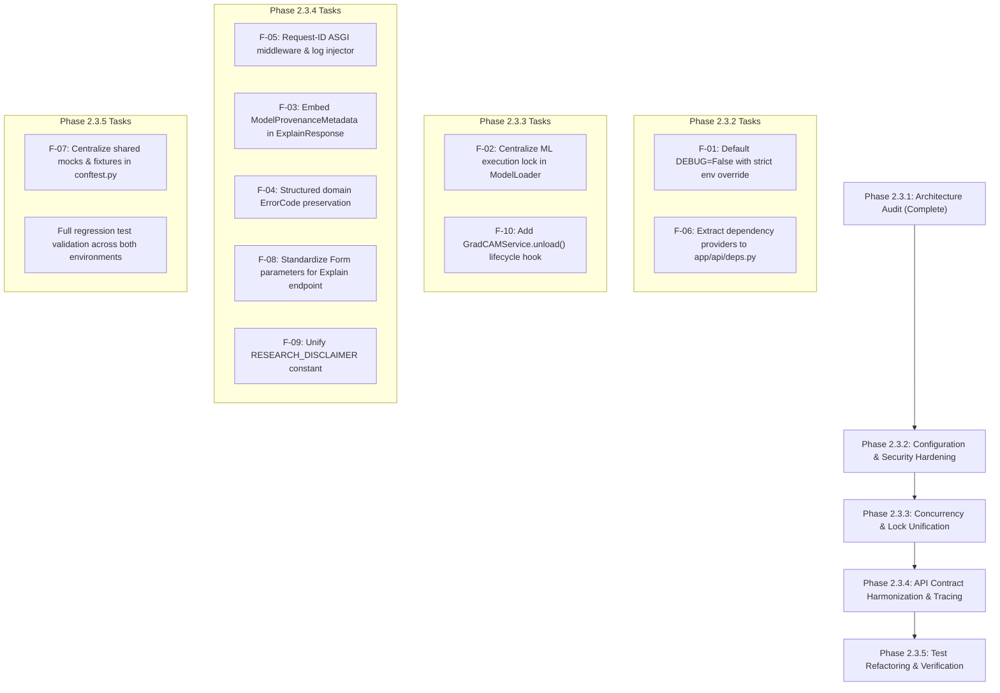

# LungCare AI — Phase 2.3.1 Backend Architecture & Integration Audit Report

**Auditor:** Principal Backend Architect & Senior Python/FastAPI Engineer  
**Milestone:** Phase 2.3.1 — Backend Integration Hardening Pre-Implementation Audit  
**Date:** November 22, 2026  
**Status:** Audit Complete  

---

## 1. Executive Summary

As LungCare AI transitions from prototype milestone delivery (Phase 2.1 – Phase 2.2.7) into **Phase 2.3 (Backend Integration Hardening)**, this comprehensive source-code-level audit inspects the architectural integrity, concurrency safety, API contract consistency, operational lifecycle, logging infrastructure, security posture, and test coverage of the entire backend codebase.

The current system provides an operational, functional research application that couples FastAPI with an isolated TensorFlow 2.17 / Keras 3.15 runtime running DenseNet121 inference and standard Grad-CAM visual explainability. The test suite comprises 176 unique automated tests passing at a 100% rate.

However, scaling the system toward robust integration reveals several hardening requirements:
1. **Contract and Schema Asymmetries:** Divergence between `POST /api/v1/predictions` and `POST /api/v1/predictions/explain` regarding model provenance metadata, telemetry fields, and disclaimer text strings.
2. **Dual Independent Execution Locks:** `InferenceService` and `GradCAMService` synchronize model execution using separate, decoupled `threading.Lock()` instances rather than a unified model execution lock, risking simultaneous TensorFlow CPU graph contention.
3. **Missing Correlation IDs & Request Tracing:** Inability to correlate interleaved log lines under concurrent HTTP traffic due to the lack of an `X-Request-ID` tracing middleware.
4. **Unsafe Configuration Default:** `DEBUG` defaults to `True` in `Settings`, triggering internal exception string leakage in global 500 error envelopes.
5. **Test Fixture Duplication:** Redundant mocking logic and test image byte generation repeated across four distinct test files in the absence of a root `conftest.py`.

No blocking defects prevent proceeding. All findings have been cataloged with source references, impact analyses, and actionable remediation steps for Phase 2.3.2 onward.

---

## 2. Current Backend Architecture

### 2.1 Directory & Component Responsibilities

The backend source tree is organized into seven modular packages under `backend/app/`:

```
backend/
├── app/
│   ├── main.py                     # Application factory, lifespan hooks, CORS, global exception handlers
│   ├── api/
│   │   └── v1/
│   │       ├── router.py           # V1 route aggregator and discovery metadata endpoint
│   │       └── endpoints/
│   │           ├── health.py       # Liveness (/health) and readiness (/ready) probes
│   │           └── predictions.py  # Prediction (/predictions) and explainability (/predictions/explain)
│   ├── core/
│   │   ├── config.py               # Pydantic BaseSettings, environment overrides, CORS parsing
│   │   └── logging.py              # Centralized logging configuration with millisecond precision
│   ├── schemas/                    # Pydantic v2 data transfer objects and validation contracts
│   │   ├── error.py                # Standardized ErrorResponse envelope and ErrorDetail
│   │   ├── health.py               # HealthResponse and ReadinessResponse schemas
│   │   ├── image.py                # ImagePreprocessingMetadata schema
│   │   ├── metadata.py             # RootMetadataResponse and APIMetadataResponse schemas
│   │   ├── prediction.py           # PredictionResponse schema
│   │   └── gradcam.py              # ExplanationMetadata and GradCAMExplainResponse schemas
│   ├── services/                   # Core business logic and ML execution domain services
│   │   ├── model_loader.py         # Thread-safe DenseNet121 lifecycle and artifact cache
│   │   ├── image_preprocessor.py   # Pillow decoding, 25 MP limit, EXIF transpose, Lanczos resize, DenseNet prep
│   │   ├── inference_service.py    # Synchronized four-class forward inference and contract checks
│   │   ├── gradcam_service.py      # Synchronized GradientTape backpropagation for conv5_block16_2_conv
│   │   └── gradcam_visualizer.py   # JET colormap blending and in-memory Base64 PNG encoding
│   └── utils/
│       └── artifact_validator.py   # Filesystem model resolution and SHA-256 baseline hash validation
└── tests/                          # Automated integration, regression, and unit test suites
```

### 2.2 Coupling, Separation of Concerns & Duplication Findings

1. **Dependency Function Colocation:**
   - *File:* `backend/app/api/v1/endpoints/predictions.py#L63-L81`
   - *Behavior:* FastAPI dependency providers (`get_inference_service_dep`, `get_gradcam_service_dep`, `get_gradcam_visualizer_dep`, `get_image_preprocessor_dep`) are defined directly within the endpoint implementation file.
   - *Impact:* Violates standard FastAPI modularity where shared dependencies belong in `backend/app/api/deps.py`. Precludes reuse by future routers (e.g. Phase 2.3/2.4 RAG or report endpoints).
2. **Dual Preprocessing Entry Points:**
   - *File:* `backend/app/services/inference_service.py#L206-L238` vs `backend/app/api/v1/endpoints/predictions.py#L241-L251`
   - *Behavior:* `InferenceService` encapsulates an internal `ImagePreprocessor` via `predict(image_bytes)`, whereas `explain_chest_xray` directly invokes `preprocessor.preprocess(content)` and feeds the tensor to `inference_service.predict_tensor()`.
   - *Impact:* Exposes two parallel ways to run inference (one accepting raw bytes, one accepting preprocessed tensors). While necessary to prevent duplicate preprocessing in the explain endpoint, the relationship should be formally unified through an explicit pipeline orchestrator.
3. **Orphaned Schema:**
   - *File:* `backend/app/schemas/image.py#L7-L65`
   - *Behavior:* `ImagePreprocessingMetadata` is defined with extensive field definitions but is neither returned by any endpoint nor embedded in response models.

---

## 3. Existing Endpoint Inventory

The backend exposes nine distinct HTTP routes across root and versioned namespaces:

| Route Path | HTTP Method | Handler Function | Purpose | Request Body | Response Model |
| :--- | :---: | :--- | :--- | :--- | :--- |
| `/` | `GET` | `main.root` | Root welcome and metadata links | None | `RootMetadataResponse` |
| `/health` | `GET` | `health.check_health` | System liveness probe | None | `HealthResponse` |
| `/ready` | `GET` | `health.check_readiness` | Subsystem readiness and model status | None | `ReadinessResponse` |
| `/openapi.json` | `GET` | `main.root_openapi_schema` | Development OpenAPI alias | None | `dict` (OpenAPI JSON) |
| `/api/v1/` | `GET` | `router.get_v1_metadata` | V1 API discovery and route index | None | `APIMetadataResponse` |
| `/api/v1/health` | `GET` | `health.check_health` | Versioned liveness probe (alias) | None | `HealthResponse` |
| `/api/v1/ready` | `GET` | `health.check_readiness` | Versioned readiness probe (alias) | None | `ReadinessResponse` |
| `/api/v1/predictions` | `POST` | `predictions.predict_chest_xray` | Four-class DenseNet121 inference | `multipart/form-data` (`image`) | `PredictionResponse` |
| `/api/v1/predictions/explain` | `POST` | `predictions.explain_chest_xray` | DenseNet121 inference + Grad-CAM | `multipart/form-data` (`image`, `target_class`, `alpha`) | `GradCAMExplainResponse` |

---

## 4. API Contract & Schema Findings

### Finding 4.1: Response Schema Metadata Asymmetry
- **File / Location:** `backend/app/schemas/prediction.py#L26-L101` vs `backend/app/schemas/gradcam.py#L99-L167`
- **Observed Behavior:**
  - `PredictionResponse` places `model_name`, `model_architecture`, `input_width`, `input_height`, `processed_width`, `processed_height`, `inference_time_ms`, and `preprocessing_time_ms` at the **root level**.
  - `GradCAMExplainResponse` nests dimensional and latency attributes inside an `explanation: ExplanationMetadata` sub-object, **omits `model_name` and `model_architecture` entirely**, and does not report `preprocessing_time_ms`.
  - `GradCAMExplainResponse` introduces a redundant `display_name` field at the root level which mirrors `predicted_label`, while `PredictionResponse` omits `display_name`.
- **Impact:** Client applications (such as a frontend dashboard) must implement divergent deserialization paths for basic model telemetry between prediction and explainability workflows.
- **Recommended Action:** Harmonize the schemas in Phase 2.3.2 by adopting a consistent base schema or embedding standard model provenance metadata across both responses while preserving backward compatibility.
- **Status:** *Potential Improvement (Medium)*

### Finding 4.2: Divergent Medical Disclaimer Strings
- **File / Location:**
  - `backend/app/schemas/prediction.py#L20-L23`
  - `backend/app/services/gradcam_service.py#L48-L52`
- **Observed Behavior:**
  - `PredictionResponse` uses:
    > `"This output is an experimental AI model prediction for research and educational purposes. It is not a medical diagnosis and must not be used as a substitute for professional medical evaluation."`
  - `GradCAMExplainResponse` uses:
    > `"LungCare AI is an experimental AI prediction model developed solely for research and educational purposes. It does not provide medical diagnosis, clinical advice, or treatment recommendations. Diagnostic evaluations must be performed by certified radiologists."`
- **Impact:** Inconsistent clinical neutrality wording across endpoints of the same research platform.
- **Recommended Action:** Extract a single canonical `RESEARCH_DISCLAIMER` constant into `backend/app/core/config.py` or a dedicated constants module, referenced by both schemas.
- **Status:** *Potential Improvement (Low)*

### Finding 4.3: Parameter Duplication in OpenAPI Documentation
- **File / Location:** `backend/app/api/v1/endpoints/predictions.py#L328-L331`
- **Observed Behavior:** `explain_chest_xray` defines `target_class` and `alpha` as both `Form(...)` and `Query(...)` parameters with manual precedence resolution in Python.
- **Impact:** In the generated OpenAPI schema (`/docs` and `/openapi.json`), both parameters appear twice in the parameter list (once under formData, once under query), creating ambiguity for API consumers and automated client code generators.
- **Recommended Action:** In Phase 2.3.2, standardize `POST /predictions/explain` parameters as pure `Form(...)` parameters in accordance with standard multipart/form-data REST conventions.
- **Status:** *Potential Improvement (Low)*

### Finding 4.4: Loss of Granular Domain Error Codes in Error Envelopes
- **File / Location:** `backend/app/api/v1/endpoints/predictions.py#L135-L178` & `L395-L461`
- **Observed Behavior:** Domain exceptions (`EmptyImageError`, `UnsupportedFormatError`, `ImageTooLargeError`, `DecompressionBombError`) define explicit `.error_code` strings (e.g. `"UNSUPPORTED_FORMAT"`, `"IMAGE_DECOMPRESSION_BOMB"`), but the endpoints re-raise standard `HTTPException(status_code=..., detail=exc.message)`. The global handler then assigns generic `"HTTPException"` to `error.error_type`.
- **Impact:** Machine clients cannot inspect a deterministic machine-readable code without string parsing the human-readable `message`.
- **Recommended Action:** Extend `HTTPException` raises or introduce a custom `AppException` that passes the domain `error_code` into `detail` or custom attributes handled by `main.py`.
- **Status:** *Potential Improvement (Medium)*

---

## 5. Lifecycle and Concurrency Findings

### Finding 5.1: Dual Independent Synchronization Locks
- **File / Location:**
  - `backend/app/services/inference_service.py#L204` (`self._inference_lock = threading.Lock()`)
  - `backend/app/services/gradcam_service.py#L161` (`self._lock = threading.Lock()`)
- **Observed Behavior:**
  - `InferenceService` synchronizes model forward execution (`model(tensor, training=False)`) using its own instance lock.
  - `GradCAMService` synchronizes auxiliary model compilation and `GradientTape` execution using a separate instance lock.
- **Impact:** Under concurrent traffic where client A requests `/predictions` and client B requests `/predictions/explain`, both locks can be acquired simultaneously by worker threads executing against the shared TensorFlow runtime. While Keras weights are frozen (`training=False`), simultaneous execution of `model(...)` and `grad_model(...)` in TensorFlow C++ on CPU can introduce memory allocation contention and non-deterministic CPU thread competition.
- **Recommended Action:** Implement a shared, centralized ML execution lock (e.g. hosted on `ModelLoader` singleton) that coordinates all TensorFlow computational graph operations across all services.
- **Status:** *Potential Improvement (High)*

### Finding 5.2: Asymmetric Model Resource Unloading During Shutdown
- **File / Location:**
  - `backend/app/main.py#L56-L65`
  - `backend/app/services/gradcam_service.py#L162`
- **Observed Behavior:** During application shutdown, the `lifespan` hook calls `ModelLoader.unload()`, resetting `_model` to `None`. However, `GradCAMService` retains its reference to `_grad_model` in memory without an `unload()` lifecycle hook.
- **Impact:** In scenarios where `ModelLoader` reloads a new model instance at runtime, `GradCAMService` would continue holding stale references to the previously loaded graph layers unless explicitly reset.
- **Recommended Action:** Add an explicit `unload()` or `reset()` method to `GradCAMService` and invoke it within the `main.py` shutdown sequence alongside `ModelLoader.unload()`.
- **Status:** *Potential Improvement (Low)*

### Finding 5.3: Verified Non-Blocking Event Loop Offload
- **File / Location:** `backend/app/api/v1/endpoints/predictions.py#L134` & `L385`
- **Observed Behavior:** Both `service.predict` and `_execute_explanation` are invoked via `starlette.concurrency.run_in_threadpool`.
- **Impact:** All CPU-bound operations (Pillow image decoding, Lanczos resampling, NumPy arrays, TensorFlow inference, gradient tape evaluation, and PNG byte serialization) execute on background worker threads. The FastAPI async event loop is strictly non-blocking.
- **Status:** *Confirmed Correct*

---

## 6. Security and Configuration Findings

### Finding 6.1: Insecure Default Setting (`DEBUG = True`)
- **File / Location:** `backend/app/core/config.py#L21`
- **Observed Behavior:** `DEBUG: bool = True` is hardcoded as the default field value on `Settings`.
- **Impact:** If `ENVIRONMENT` or `DEBUG` is not explicitly overridden in production deployment environments:
  1. Interactive Swagger `/docs` and `/redoc` remain publicly accessible.
  2. The unhandled exception handler in `main.py#L161-L163` emits raw exception strings and class names:
     ```python
     if settings.DEBUG:
         message = f"Internal server error: {str(exc)}"
         details = {"exception_type": exc.__class__.__name__}
     ```
     This risks leaking internal file paths, framework versions, or memory addresses to untrusted clients.
- **Recommended Action:** Change the default in `Settings` to `DEBUG: bool = False`, and require explicit opt-in via environment variable (`DEBUG=true`) for local development.
- **Status:** *Confirmed Defect / Security Hardening (High)*

### Finding 6.2: Verified Upload and Decompression Bomb Protection
- **File / Location:**
  - `backend/app/api/v1/endpoints/predictions.py#L105-L123`
  - `backend/app/services/image_preprocessor.py#L370-L390`
- **Observed Behavior:**
  1. `await image.read(max_bytes + 1)` prevents memory exhaustion from unbounded stream uploads.
  2. Payloads $> 10$ MB are rejected immediately before decoding.
  3. Pillow's `Image.MAX_IMAGE_PIXELS = 25_000_000` is enforced alongside explicit width $\times$ height validation before image arrays are loaded into memory.
  4. Header verification (`img.verify()`) detects format spoofing independently of HTTP `Content-Type`.
- **Impact:** Complete mitigation against memory exhaustion attacks, slow-read stream attacks, and image decompression bombs.
- **Status:** *Confirmed Correct*

### Finding 6.3: Permissive CORS Default Origins
- **File / Location:** `backend/app/core/config.py#L36-L41`
- **Observed Behavior:** `CORS_ORIGINS` defaults to local ports 3000 and 5173 on `localhost` and `127.0.0.1`.
- **Impact:** Safe for development, but requires strict validation that production deployments configure explicit domain origins rather than relying on development defaults.
- **Status:** *Confirmed Correct (Development Scoped)*

---

## 7. Logging and Observability Findings

### Finding 7.1: Absence of Request Correlation Tracking (Request IDs)
- **File / Location:** `backend/app/core/logging.py#L12`
- **Observed Behavior:** Log records use format:
  `"%(asctime)s.%(msecs)03d | %(levelname)-8s | %(name)s:%(funcName)s:%(lineno)d - %(message)s"`
  There is no `request_id` or trace context associated with log emissions.
- **Impact:** When multiple concurrent prediction or explanation requests execute simultaneously, log records from different client sessions interleave chronologically. Diagnosing an isolated failure or tracking end-to-end request latency for a single transaction in production logs is exceptionally difficult.
- **Recommended Action:** Implement a lightweight ASGI middleware (or dependency) in Phase 2.3.2 that:
  1. Extracts incoming `X-Request-ID` or generates a UUID4.
  2. Sets a `contextvars.ContextVar` for the request lifecycle.
  3. Injects `request_id` into the log formatter and returns it in response headers.
- **Status:** *Potential Improvement / Observability Hardening (Medium)*

### Finding 7.2: Absence of Operational Telemetry Metrics
- **File / Location:** `backend/app/api/v1/router.py`
- **Observed Behavior:** High-resolution latency timings are calculated per request (`inference_time_ms`, `preprocessing_time_ms`, `gradcam_time_ms`), but they are returned only in individual JSON response envelopes. No aggregated operational metrics (request rates, error counts by status code, latency percentiles $p50, p95, p99$) are collected or exposed.
- **Impact:** System administrators cannot monitor service health trends, identify performance regressions under load, or configure alerts without third-party APM agents.
- **Recommended Action:** In future hardening (Phase 2.3.3+), evaluate introducing standard Prometheus metric instrumentation or structured JSON log formatting for log aggregation platforms.
- **Status:** *Recommendation (Low)*

---

## 8. Test Coverage Assessment

### 8.1 Existing Test Suite Distribution
The automated test suite contains **176 unique automated tests** across eight test modules:

| Test Module Path | Test Count | Scope & Focus Areas |
| :--- | :---: | :--- |
| `backend/tests/test_health.py` | 12 | Health probes, readiness, CORS, OpenAPI root alias, logging format |
| `backend/tests/test_model_loader.py` | 20 | Model loading, SHA-256 hash checks, config schema, smoke tests, singleton lock |
| `backend/tests/test_image_preprocessor.py` | 22 | Formats (JPEG/PNG/WEBP), EXIF transposition, white alpha composite, 25 MP limit, Lanczos resize |
| `backend/tests/test_inference_service.py` | 27 | Forward pass, probability sum=1.0, TURBERCULOSIS label mapping, latency checks, concurrency |
| `backend/tests/test_prediction_endpoint.py` | 22 | POST /predictions HTTP contracts, upload errors (400, 413, 415, 422, 502, 503), threadpool |
| `backend/tests/test_gradcam_service.py` | 30 | GradientTape backpropagation, target conv layer, uninformative zero-gradient detection |
| `backend/tests/test_gradcam_visualizer.py` | 19 | JET colormap math, alpha blending, in-memory PNG bytes, Base64 data URIs |
| `backend/tests/test_explain_endpoint.py` | 24 | POST /predictions/explain HTTP contracts, target class selection, alpha, zero disk writes |
| **Total Unique Tests** | **176** | **100% Pass Rate across all modules** |

### 8.2 Test Organization & Infrastructure Gaps

1. **Test Double & Fixture Duplication:**
   - `MockInferenceService` is implemented in `test_prediction_endpoint.py#L65-L108` and re-implemented with minor variations in `test_explain_endpoint.py#L93-L135`.
   - Helper function `create_test_image_bytes()` is defined independently in `test_prediction_endpoint.py`, `test_explain_endpoint.py`, `test_image_preprocessor.py`, and `test_gradcam_visualizer.py`.
   - *Impact:* Violates DRY principles. Fixture changes must be manually copied across four files.
   - *Remediation:* Create a central `backend/tests/conftest.py` exporting shared fixtures and mock doubles.
2. **Environment Dependency Friction:**
   - In `backend/.venv-ml`, running `pytest` without `anyio` installed causes async endpoint tests to be skipped unless run in an environment providing `anyio` or `pytest-asyncio`.
   - Host Python on Windows requires loopback socket access for async test clients.
   - *Remediation:* Standardize test runner documentation or add `pytest-anyio` to ML development requirements.

---

## 9. Categorized Findings Summary

| ID | Category | Severity | Description | Nature |
| :---: | :--- | :---: | :--- | :---: |
| **F-01** | Security | **High** | Insecure default `DEBUG = True` leaks exception strings and enables public docs. | Confirmed Defect |
| **F-02** | Concurrency | **High** | Dual independent synchronization locks (`InferenceService` vs `GradCAMService`) risk TensorFlow graph contention under concurrency. | Potential Risk |
| **F-03** | API Contract | **Medium** | Response schema asymmetry between `PredictionResponse` and `GradCAMExplainResponse` (missing model metadata). | Inconsistency |
| **F-04** | API Contract | **Medium** | Domain error code strings (e.g. `UNSUPPORTED_FORMAT`, `EMPTY_FILE`) lost in generic `HTTPException` envelopes. | Potential Improvement |
| **F-05** | Observability| **Medium** | Absence of `X-Request-ID` tracing middleware impedes single-request log correlation under concurrent traffic. | Potential Improvement |
| **F-06** | Architecture | **Low** | Dependency providers colocated inside endpoint module rather than a dedicated `deps.py`. | Architecture Debt |
| **F-07** | Testing | **Low** | Repeated mock services and `create_test_image_bytes()` across multiple test files in absence of `conftest.py`. | Technical Debt |
| **F-08** | API Contract | **Low** | Dual Form/Query parameter definitions on `POST /predictions/explain` cause duplicate parameter entries in OpenAPI docs. | Documentation Debt |
| **F-09** | API Contract | **Low** | Slight wording variance between disclaimer constants in `prediction.py` and `gradcam_service.py`. | Inconsistency |
| **F-10** | Lifecycle | **Low** | `GradCAMService` lacks an explicit `unload()` hook during application shutdown. | Technical Debt |

---

## 10. Recommended Remediation Plan for Phase 2.3.2 Onward

The following staged remediation plan addresses all audit findings systematically without breaking backward compatibility:



### Next Immediate Step
Submit this audit report for architectural review. Do not implement any source code modifications until Phase 2.3.2 is explicitly authorized.
