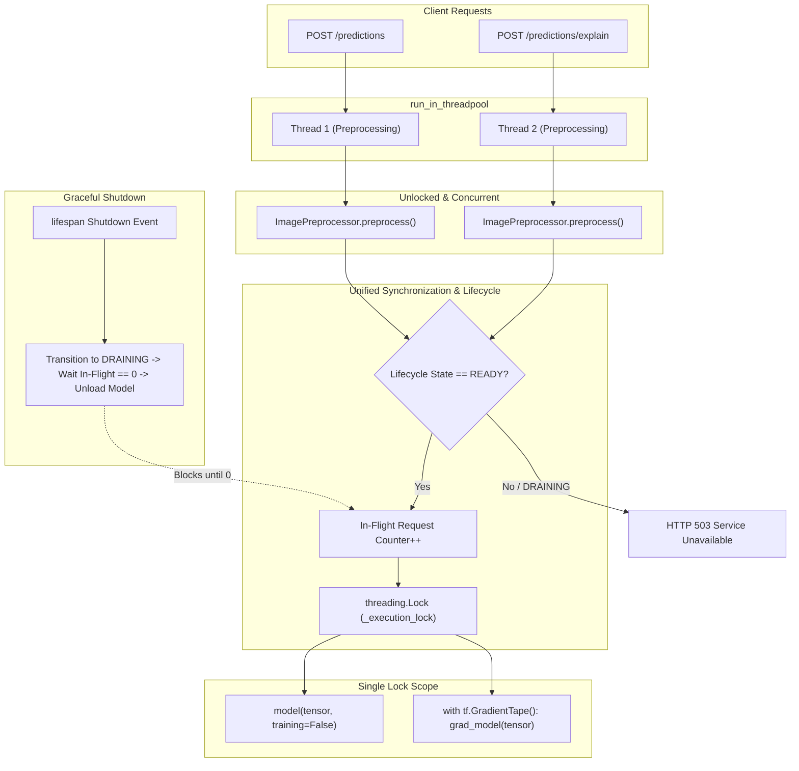

# Phase 2.3.3.1 — Principal-Level Concurrency Architecture Audit

**Project:** LungCare AI  
**Milestone:** Phase 2.3.3.1 — Principal-Level Concurrency Architecture Audit  
**Auditor Role:** Principal Python Backend Engineer (FastAPI, TensorFlow/Keras Concurrency, Thread Safety, ML Lifecycle)  
**Date:** November 2026  
**Status:** COMPLETE & AUDITED  

---

## 1. Current Architecture and Execution Flow

The LungCare AI platform exposes two ML-dependent REST endpoints via FastAPI:
1. `POST /api/v1/predictions` — Four-class chest X-ray classification.
2. `POST /api/v1/predictions/explain` — Classification inference paired with class-specific Grad-CAM visual activation mapping and image overlay generation.

Both endpoints are asynchronous (`async def`) and offload blocking, CPU-intensive ML and image-processing tasks to worker threads via Starlette's `run_in_threadpool`.

### A. Component Interaction Graph
```
FastAPI Router (endpoints/predictions.py)
   │
   ├──> run_in_threadpool
   │       │
   │       ├──> ImagePreprocessor.preprocess(bytes)  [Stateless, Unlocked]
   │       │
   │       ├──> InferenceService.predict_tensor(tensor)
   │       │       │
   │       │       ├──> ModelLoader.get_model()  [Singleton access]
   │       │       └──> with self._inference_lock:  [Instance Lock 1]
   │       │               └──> model(tensor, training=False)
   │       │
   │       ├──> GradCAMService.generate_heatmap(tensor, target_idx)
   │       │       │
   │       │       ├──> ModelLoader.get_model()  [Singleton access]
   │       │       └──> with self._lock:  [Instance Lock 2]
   │       │               └──> with tf.GradientTape():
   │       │                       └──> grad_model(tensor, training=False)
   │       │
   │       └──> GradCAMVisualizer.create_overlay(...)  [Stateless, Unlocked]
```

### B. End-to-End Execution Paths

#### 1. Application Startup & Model Loading Lifecycle
- **Path:** `lifespan(app)` in `backend/app/main.py` -> `ModelLoader.load_model()`.
- `ModelLoader.load_model()` employs double-checked locking using `ModelLoader._lock` (`threading.Lock`).
- Cryptographic artifact validation (`validate_artifacts`) hashes all 4 files against approved SHA-256 baselines before calling `keras.models.load_model(primary_path, compile=False)`.
- If startup loading fails, the error is caught and logged, allowing degraded startup for liveness probes.

#### 2. Normal Prediction Requests (`POST /api/v1/predictions`)
1. Client uploads image bytes via multipart form data.
2. Endpoint reads bytes with upload bounds check (`settings.MAX_IMAGE_UPLOAD_BYTES`).
3. Endpoint dispatches `service.predict(content)` to `run_in_threadpool`.
4. `ImagePreprocessor.preprocess(bytes)` executes on the worker thread outside any lock.
5. `InferenceService.predict_tensor()` executes:
   - Resolves `model = self._get_model_instance()` (calls `ModelLoader.get_model()`).
   - Enters `with self._inference_lock:`.
   - Executes `raw_output = model(tensor, training=False)` and `raw_output.numpy()`.
   - Exits `with self._inference_lock:`.
6. Output tensor contract validation, class mapping, and telemetry formatting execute outside the lock.
7. Returns `PredictionResponse`.

#### 3. Grad-CAM Explanation Requests (`POST /api/v1/predictions/explain`)
1. Client uploads image bytes with optional `target_class` and `alpha`.
2. Endpoint dispatches `_execute_explanation` to `run_in_threadpool`.
3. `ImagePreprocessor.preprocess(bytes)` executes outside any lock.
4. `InferenceService.predict_tensor()` executes:
   - Enters `with self._inference_lock:`.
   - Runs forward pass `model(tensor, training=False)`.
   - Exits `with self._inference_lock:`.
5. Target class index is determined (from query parameter or predicted class).
6. `GradCAMService.generate_heatmap()` executes:
   - Enters `with self._lock:`.
   - Calls `self._build_or_get_grad_model()` (reuses loaded model layers).
   - Executes forward pass and backward pass inside `tf.GradientTape()`.
   - Computes `grads = tape.gradient(class_score, conv_outputs)`.
   - Exits `with self._lock:`.
7. Feature map validation, global average pooling, ReLU, and spatial bilinear resizing execute.
8. `GradCAMVisualizer.create_overlay()` executes outside any lock.
9. Returns `GradCAMExplainResponse`.

#### 4. Simultaneous Prediction and Explanation Requests
- **Worker Thread A** (`/predictions`): Acquires `InferenceService._inference_lock` and runs forward inference.
- **Worker Thread B** (`/predictions/explain`): Acquires `GradCAMService._lock` and runs `grad_model(input_tensor)` / `tape.gradient()`.
- **Finding:** Because `_inference_lock` and `_lock` are independent objects, **both threads execute TensorFlow/Keras operations simultaneously against the shared model weights and layers**.

#### 5. Application Shutdown & Model Unloading
- **Path:** `lifespan(app)` shutdown block in `backend/app/main.py` -> `ModelLoader.unload()`.
- `ModelLoader.unload()` enters `with self._lock:` and sets `_model = None`, `_metadata = None`, `_is_loaded = False`.
- `unload()` does **not** check or coordinate with `InferenceService._inference_lock` or `GradCAMService._lock`.

---

## 2. Existing Locks and Their Exact Scope

| Service Singleton | Lock Variable | Lock Type | Scope of Protection | Operations Executing Outside Lock |
| :--- | :--- | :--- | :--- | :--- |
| `ModelLoader` | `self._lock` | `threading.Lock` | Protects `load_model()` double-checked initialization and `unload()` attribute resetting. | Model forward execution, gradient computation, and disk reads after initial validation. |
| `InferenceService` | `self._inference_lock` | `threading.Lock` | Exclusively wraps `model(tensor, training=False)` and `raw_output.numpy()`. | Raw byte reading, Image preprocessing, output contract validation, class mapping, latency calculations. |
| `GradCAMService` | `self._lock` | `threading.Lock` | Wraps `_build_or_get_grad_model()`, forward pass under `tf.GradientTape()`, and `tape.gradient()`. | Input tensor validation, class index resolution, GAP pooling, ReLU, upsampling, colormap overlay rendering. |
| `ImagePreprocessor` | *None* | *None* | Completely stateless and reentrant. | 100% unlocked (safe). |
| `GradCAMVisualizer`| *None* | *None* | Completely stateless and reentrant. | 100% unlocked (safe). |

---

## 3. Confirmed Risks vs. Theoretical Risks

### A. Confirmed Concurrency Risks (Action Required)

1. **Dual Independent Lock Fragmentation (CRITICAL):**
   - `InferenceService._inference_lock` and `GradCAMService._lock` are independent lock instances.
   - When a prediction request and an explainability request execute concurrently across AnyIO thread-pool workers, Thread A runs forward inference while Thread B runs backpropagation through the exact same Keras layers (`subsequent_layers` in `GradCAM_Nested_Model` are the identical Python layer references from `model.layers`).
   - **Impact:** In TensorFlow 2.x eager mode on CPU, concurrent calls across threads on the same layer instances risk corrupted intermediate layer state, tensor buffer races, and OpenMP thread contention.

2. **Uncoordinated Model Unload during Shutdown (HIGH):**
   - `ModelLoader.unload()` acquires only `ModelLoader._lock`. It has zero visibility into whether `InferenceService` or `GradCAMService` is actively running an inference pass inside `run_in_threadpool`.
   - If an HTTP request is in-flight when FastAPI lifespan initiates shutdown, `ModelLoader.unload()` dereferences `self._model = None`.
   - Any worker thread reaching `self._get_model_instance()` during this window either encounters `ModelUnavailableError` or triggers an unexpected, uncoordinated full model reload from disk while the server is terminating.

3. **Multi-Step Unprotected Gap in Explainability Pipeline (MEDIUM):**
   - In `_execute_explanation()` ([predictions.py#L239-L258](file:///c:/Users/ASUS/OneDrive/Desktop/LungCare-AI/backend/app/api/v1/endpoints/predictions.py#L239-L258)):
     - Step 2 calls `inference_service.predict_tensor()`, which acquires and releases `_inference_lock`.
     - Step 4 calls `gradcam_service.generate_heatmap()`, which acquires and releases `gradcam_service._lock`.
   - Between Step 2 and Step 4, another thread can interleave an inference or explanation request. While mathematically acceptable for independent requests, the lack of an overarching coordination model makes telemetry and error boundaries fragmented.

### B. Theoretical Risks (Investigated & Disproven)

1. **Deadlock Inversion Risk (THEORETICAL - NOT PRESENT):**
   - Neither `InferenceService` nor `GradCAMService` acquires a second lock while holding its own lock.
   - `ModelLoader.get_model()` is called *prior* to entering `with self._inference_lock:` in `InferenceService`.
   - In `GradCAMService`, `self._build_or_get_grad_model()` calls `ModelLoader.get_model()` under `self._lock`, but `ModelLoader` does not attempt to acquire `GradCAMService._lock`.
   - There are currently no cyclic lock acquisition patterns in the codebase.

2. **Preprocessing Contention (THEORETICAL - NOT PRESENT):**
   - `ImagePreprocessor` is stateless. PIL images and NumPy buffers are allocated locally per thread.
   - Preprocessing does not touch TensorFlow model objects or shared globals. Keeping it unlocked is safe and optimal.

3. **Multi-Worker Process Collisions (THEORETICAL - NOT APPLICABLE):**
   - When deployed with Uvicorn multi-worker mode (`--workers N`), each worker is an independent OS process with its own virtual memory space, Python interpreter, and TensorFlow runtime.
   - Process memory isolation eliminates cross-process Python thread race conditions. Concurrency risks are strictly intra-process across threadpool threads.

---

## 4. Architecture Options Comparison

| Evaluation Dimension | Option A: Shared `threading.Lock` | Option B: Coordinator with Lifecycle States & Tracking | Option C: Dedicated Single-Worker Executor | Option D: Reader-Writer Lock |
| :--- | :--- | :--- | :--- | :--- |
| **Description** | A single shared `threading.Lock` shared between `InferenceService` and `GradCAMService`. | A centralized `MLExecutionCoordinator` managing unified lock, model state machine, and in-flight request tracking. | Internal `ThreadPoolExecutor(max_workers=1)` queue executing all ML operations sequentially. | `RWLock` allowing concurrent forward passes, exclusive Grad-CAM. |
| **Thread Safety** | **High:** Eliminates inference vs. Grad-CAM race conditions. | **Complete:** Full mutual exclusion plus lifecycle transition safety. | **Complete:** Strict single-thread serial execution. | **Flawed:** Keras layers are not thread-safe for concurrent forward execution in eager mode. |
| **Model Lifecycle Safety** | **Low:** `unload()` can still race with active requests unless manually coordinated. | **High:** `DRAINING` state prevents new requests while active requests complete before unloading. | **High:** Shutdown cancels or drains executor queue cleanly. | **Low:** Same vulnerability as Option A. |
| **Throughput Impact** | **Optimal for CPU:** Serializes ML forward/backward passes while keeping preprocessing concurrent. | **Optimal for CPU:** Same as Option A. | **Moderate Penalty:** Task queue scheduling and context-switch latency. | **Negative:** Reader lock gives false concurrency while causing CPU thread-thrashing. |
| **Latency Overhead** | Negligible (<0.01 ms). | Negligible (<0.02 ms). | 0.5–2.0 ms task dispatch overhead. | Moderate (RWLock tracking). |
| **Implementation Complexity** | Minimal (1–2 files). | Low to Moderate (clean, encapsulated coordinator). | Moderate (queue management, timeout, cancellation). | High (complex synchronization). |
| **Compatibility with FastAPI** | 100% compatible with `run_in_threadpool`. | 100% compatible with `run_in_threadpool`. | Requires bridging `Future` to `asyncio` or threadpool. | 100% compatible. |

---

## 5. Recommended Architecture: Option B (ML Execution Coordinator)

### Architecture Overview
Introduce a centralized, thread-safe service: **`MLExecutionCoordinator`**.

The Coordinator:
1. **Owns the Single ML Execution Lock (`_execution_lock`):** Both `InferenceService.predict_tensor` and `GradCAMService.generate_heatmap` acquire this unified lock when invoking TensorFlow/Keras operations.
2. **Tracks Active In-Flight Executions (`_active_requests`):** Uses an atomic counter and condition variable to track active operations.
3. **Manages Model Lifecycle State Machine:**
   - `UNLOADED`: Model not in memory.
   - `LOADING`: Model currently loading from disk.
   - `READY`: Operational for predictions and explainability.
   - `DRAINING`: Server shutting down; new requests rejected (HTTP 503), in-flight requests allowed to finish.
   - `ERROR`: Model failed validation or loading.
4. **Preserves Unlocked Preprocessing:** Image decoding and Lanczos resizing remain 100% concurrent and outside the execution lock.

### Mermaid Architecture Diagram


---

## 6. Proposed Implementation Sequence

The remediation should be executed in a dedicated, subsequent milestone (Phase 2.3.3.2) following this disciplined sequence:

1. **Step 1: Implement `MLExecutionCoordinator` (`backend/app/services/ml_coordinator.py`)**
   - Define lifecycle states: `ModelLifecycleState` enum (`UNLOADED`, `LOADING`, `READY`, `DRAINING`, `ERROR`).
   - Implement `acquire_execution()` context manager providing unified `threading.Lock` protection and active request counting.
   - Implement `drain_and_unload(timeout_seconds=5.0)`.
2. **Step 2: Update `ModelLoader` (`backend/app/services/model_loader.py`)**
   - Coordinate with `MLExecutionCoordinator` during `load_model()` and `unload()`.
3. **Step 3: Refactor `InferenceService` (`backend/app/services/inference_service.py`)**
   - Replace private `self._inference_lock` with coordinator's `acquire_execution()`.
4. **Step 4: Refactor `GradCAMService` (`backend/app/services/gradcam_service.py`)**
   - Replace private `self._lock` with coordinator's `acquire_execution()`.
5. **Step 5: Update FastAPI Dependency Provider (`backend/app/api/deps.py`)**
   - Register `get_ml_coordinator()` singleton and inject into services.
6. **Step 6: Update Application Lifespan (`backend/app/main.py`)**
   - In shutdown hook, call `coordinator.drain_and_unload()` to gracefully drain in-flight inference requests before releasing TensorFlow memory.

---

## 7. Detailed Deterministic Test Plan

All concurrency tests must use deterministic synchronization primitives (`threading.Event`, `threading.Barrier`) rather than arbitrary `time.sleep()` delays.

### Test Matrix

| Test Scenario | Deterministic Mechanism | Verification Objective |
| :--- | :--- | :--- |
| **1. Simultaneous Predictions** | `threading.Barrier(2)` before `acquire_execution()` | Verify two threads serialize cleanly through the coordinator lock without output corruption. |
| **2. Prediction + Grad-CAM Concurrently** | Mock forward pass pauses on `Event.wait()`; Grad-CAM thread attempts lock acquisition. | Assert `coordinator.is_locked` is `True`; Grad-CAM blocked until prediction completes. |
| **3. Multiple Grad-CAM Requests** | Thread pool with 4 workers and `threading.Barrier(4)`. | Verify all 4 heatmaps match expected numerical bounds without race conditions on layer feature maps. |
| **4. Request During Startup Loading** | `Event` holds `load_model()` in `LOADING` state; incoming request arrives. | Incoming request waits for lock or receives structured `503 Service Unavailable`. |
| **5. Shutdown During Active Inference** | Active inference holds execution lock; shutdown calls `drain_and_unload()`. | Verify shutdown waits up to timeout for active request to finish; subsequent requests receive 503. |
| **6. Exception Inside Locked Execution** | Injected `RuntimeError` during `model(tensor)`. | Verify exception is raised and converted to `InferenceExecutionError`; lock is **guaranteed released** via `finally`. |
| **7. Lock Release Verification** | Immediate follow-up inference call after failed call. | Verify subsequent request acquires lock immediately with zero hang. |
| **8. Deadlock & Starvation Prevention** | 10 rapid alternating prediction/explain calls with timeout assertions (`wait(timeout=10.0)`). | Verify all futures complete within bounded time with zero deadlocks. |

---

## 8. Files Expected to Change (in Phase 2.3.3.2)

1. `backend/app/services/ml_coordinator.py` *(New file)* — Coordinator service, lifecycle enum, synchronized context manager.
2. `backend/app/services/model_loader.py` — Lifecycle state integration.
3. `backend/app/services/inference_service.py` — Delegate locking to coordinator.
4. `backend/app/services/gradcam_service.py` — Delegate locking to coordinator.
5. `backend/app/api/deps.py` — Register coordinator singleton.
6. `backend/app/main.py` — Shutdown lifespan graceful drain.
7. `backend/tests/test_concurrency_coordinator.py` *(New test file)* — Deterministic multi-threaded test suite.

---

## 9. Backward-Compatibility Considerations

The proposed `MLExecutionCoordinator` architecture guarantees 100% backward compatibility:
- **Zero API Contract Changes:** HTTP endpoints, request schemas, and response JSON formats for `/predictions` and `/predictions/explain` remain identical.
- **Zero Numerical Drift:** DenseNet121 model weights, softmax probabilities, class order (`COVID19`, `NORMAL`, `PNEUMONIA`, `TURBERCULOSIS`), and Grad-CAM layer (`conv5_block16_2_conv`) are untouched.
- **Zero Preprocessing Alteration:** Image validation, decompression bomb mitigation, and 224x224 Lanczos resizing execute identically.
- **Lazy Loading Preservation:** Model loading continues to defer to startup lifespan or first explicit invocation.

---

## 10. Audit Verdict

The concurrency architecture of LungCare AI has been thoroughly analyzed. The identified risks (lock fragmentation and uncoordinated shutdown) are clear, well-isolated, and ready for remediation under the approved design.

**CONCURRENCY AUDIT — APPROVED FOR IMPLEMENTATION**
